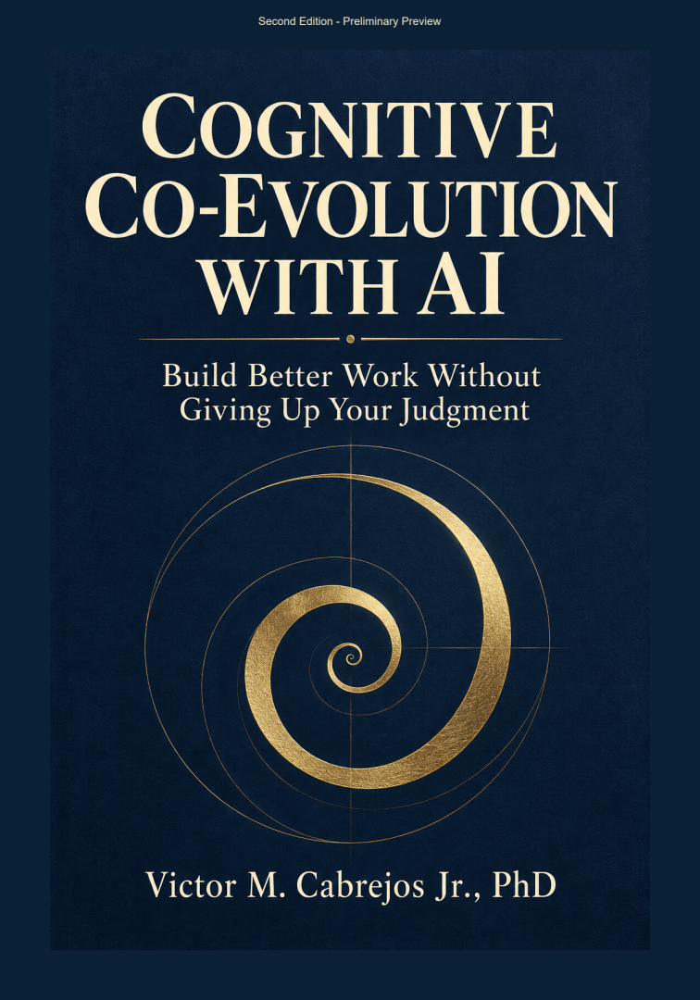

# Cognitive Co-Evolution with AI

### Build better work without giving up your judgment.

**CCEwAI · A framework by Victor M. Cabrejos Jr.**

[Book and preview status](book/README.md) · [Chapter resources](chapters/README.md) · [Framework overview](docs/overview.md)

Cognitive Co-Evolution with AI is a practical philosophy and design approach for working with AI while developing human understanding, judgment, and agency. It asks two questions of a collaboration: **What useful work did we produce? What can the person now understand and do?**

The human gives the work its purpose, meaning, criteria, and boundaries. AI contributes explanation, analysis, criticism, creation, and bounded execution. Continuing inquiry, correction, and application can make the collaboration more useful and leave the person better prepared for the next problem.

> Centrality is engineered, not granted.

 

## Choose a place to begin

Check the [book and preview status](book/README.md), explore one question through the [chapter companion](chapters/README.md), or use the [overview](docs/overview.md) for the framework's main distinctions. These resources are available to everyone. No coding background, Python installation, or additional account is required to read and use them.

Each chapter offers a short cheat sheet, a practical activity, a self-check, and explained answers. Try an answer in your own words before consulting the explanation; then return to the book where a distinction remains unclear.

| Part | Chapter companion |
| --- | --- |
| I · The Human Question | [01 · The fear deserves a better answer](chapters/01/README.md) |
| | [02 · When the artifact advances and the person does not](chapters/02/README.md) |
| | [03 · Decide what better means](chapters/03/README.md) |
| | [04 · Begin before you are an expert](chapters/04/README.md) |
| II · Designing the Collaboration | [05 · Cognitive safety is part of correctness](chapters/05/README.md) |
| | [06 · The Vortex and its four layers](chapters/06/README.md) |
| | [07 · Memory that survives the conversation](chapters/07/README.md) |
| | [08 · From helpful answers to dependable systems](chapters/08/README.md) |
| III · Beyond Individual Learning | [09 · Teach the loop, then test the learner](chapters/09/README.md) |
| | [10 · When institutions reward the artifact](chapters/10/README.md) |
| IV · The Next Evolution | [11 · Build something that gives time back](chapters/11/README.md) |
| | [12 · Your next loop](chapters/12/README.md) |

## Begin with a Vortex

The **Vortex** is the framework's foundational cell: a purposeful human–AI inquiry that returns to a problem with clearer understanding and preserved learning. Curiosity keeps the inquiry moving; judgment gives it direction.

Begin with one real question, one accessible assistant, and evidence you can inspect. Contribute your own attempt, challenge an explanation, try a changed example, and save the reason behind a useful correction. A polished answer alone does not demonstrate learning.

## Grow a connected practice

- A **Vortex of Vortexes** intentionally connects purposeful inquiries across work, learning, projects, and daily life. Carry useful understanding between them while preserving their evidence and boundaries.
- The **Triple Evolution Model** distinguishes changes in AI tools, adaptation of the working system to its human, and the human's cognitive development. **AI-to-AI Evolution** adds an exchange layer without replacing those three processes.
- **Multi-AI Strategy** organizes complementary contributions under human criteria. The second-edition draft uses **Multi SI Strategy** as its preferred name.
- **Delegated Cognitive Orchestration** lets coordinating systems organize permitted handoffs and surface useful connections while the human retains purpose, correction, review, and authority.
- **Cognitive Sovereignty** preserves understandable memory, criteria, files, and learning beyond any single platform.

Read the [framework overview and diagrams](docs/overview.md) for these distinctions and a small practice to try.

## The book

*Cognitive Co-Evolution with AI: Build Better Work Without Giving Up Your Judgment* develops the framework through practical examples and reflective questions. The English second edition is in preliminary review.

See [book status and preview information](book/README.md).

The complete 206-page public preliminary preview is prepared. Its download link will appear on the book page when the upload is complete.

## Scope and attribution

CCEwAI is the author's conceptual framework. This repository does not claim that the framework as a whole has been empirically validated. Contextual adaptation and exchanges between assistants do not, by themselves, retrain a model's underlying weights. Named tools or institutions do not imply endorsement.

[How to cite](CITATION.md) · [Copyright and permissions](RIGHTS.md) · [Author on GitHub](https://github.com/VictorCabrejos)
