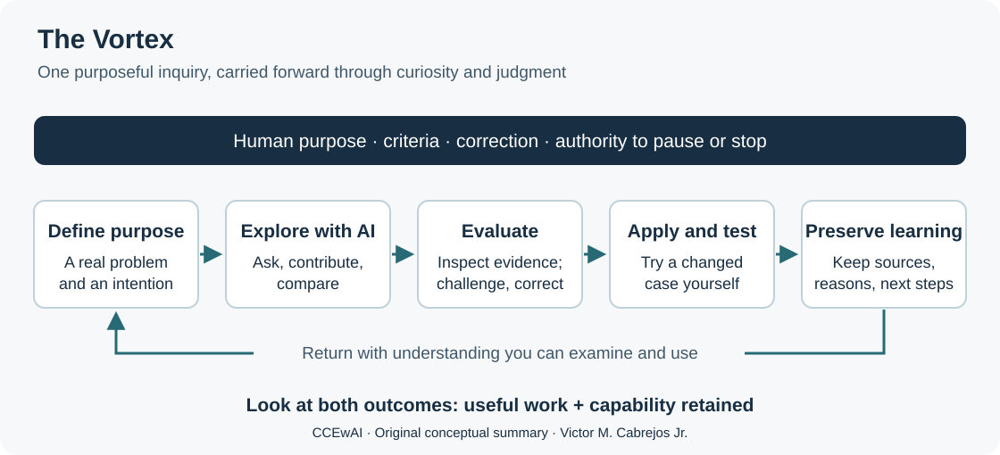
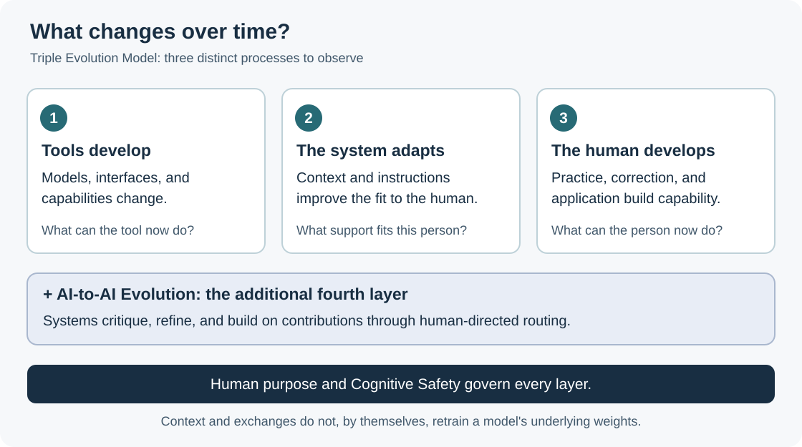
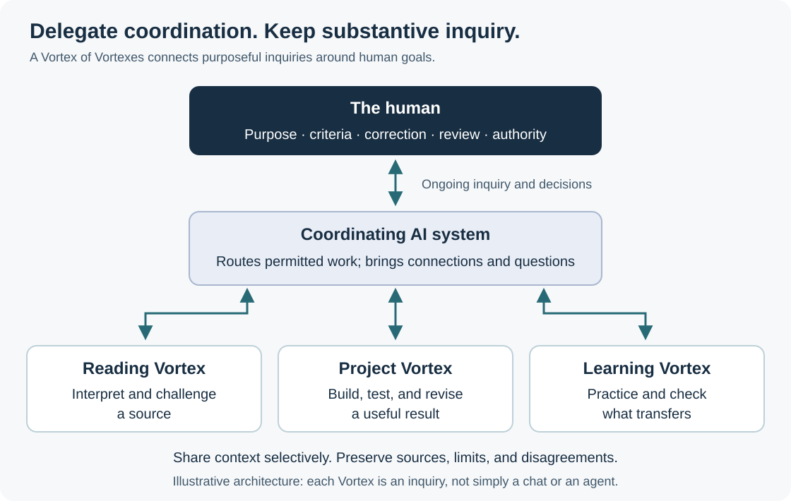

# A practical overview of CCEwAI

Cognitive Co-Evolution with AI attends to the work a collaboration produces and the capability the person carries forward. Both deserve examination. A useful result may save time; learning becomes visible when the person can explain a reason, test a claim, or adapt the work under changed conditions.

The human defines what **better** means. The framework calls this role **Objective Function (the human as)**: purpose, quality, values, constraints, acceptance, and stopping conditions. **Human as Semantic Center** preserves what the work means in context. These are architectural metaphors for human responsibility.

## The Vortex: purposeful inquiry that deepens

The Vortex is a continuing loop of intention, AI contribution, human evaluation and correction, application, and preserved learning. A short question can begin it. The deeper practice follows a worthwhile problem through curiosity, active contribution, reflection, and intellectual humility.

The author's proposal associates this deeper evolution with sustained absorption or flow. That is a conceptual condition within CCEwAI; it is not an established scientific requirement for all learning. Engagement itself does not demonstrate growth. Check what you can now explain or apply, and retain the freedom to pause or stop.

**Operative Augmentation** helps produce the work. **Cognitive Augmentation** also develops understanding and judgment. The framework's longer-term aspiration, **Neuroplastic Transformation**, concerns durable changes in how a person thinks and learns; these examples do not establish a particular biological effect.

## Three evolutions and an additional exchange layer

The **Triple Evolution Model** keeps three different changes visible:

1. **AI tools and capabilities develop.** A provider may improve or replace a model, interface, or tool.
2. **The working system adapts to its human.** Instructions, relevant context, accepted corrections, accessible memory, and tools can improve the fit to the person's goals and constraints.
3. **The human develops through the Vortex.** Practice, explanation, correction, and application can strengthen understanding and judgment. Retention and transfer need examination.

**AI-to-AI Evolution** is the additional fourth layer: systems critique, refine, or build on one another's contributions through human-directed routing. Contextual adaptation and exchanged outputs do not establish changes to model weights or automatic improvement.

**Cognitive Safety** constrains every layer. The interaction should help the person think, decide, learn, and act without avoidable burden. Accuracy and necessary disagreement remain part of that responsibility.

## Connect inquiries and coordinate contributions

A **Vortex of Vortexes** intentionally connects purposeful inquiries around a person's goals. An insight from reading can inform a lesson; a question from teaching can expose an assumption in a project. Each inquiry retains its own evidence, purpose, and limits. More chats alone do not create this arrangement.

**Multi-AI Strategy**, called **Multi SI Strategy** in the second-edition draft, concerns cooperation among systems: proposing, criticizing, comparing, revising, or evaluating contributions against human criteria. A **Multi-AI System** is an architecture for carrying it out. Agreement among assistants is not independent evidence that a claim is correct.

**Delegated Cognitive Orchestration** concerns coordination. One or more coordinating systems proactively organize other systems and purposeful Vortices, bring relevant updates and connections to the person, and surface decisions that need attention. The person continues substantive inquiry with the coordinator and retains purpose, criteria, correction, review, and authority. Supported exchanges remain within agreed permissions.

These terms answer different questions. The Vortex is an inquiry, a Vortex of Vortexes connects inquiries, Multi-AI Strategy organizes contributions from systems, and Delegated Cognitive Orchestration delegates permitted coordination. They are not interchangeable names for a chat or an agent.

## Preserve understanding and practical authority

**Cognitive Sovereignty** means preserving memory, criteria, files, and learning outside any single platform. A portable note is more useful when it includes the reason for an accepted correction, its source, and the next unresolved question.

**Engineered Centrality** puts authority into practice: usable evidence, clear criteria, and the ability to reject, revise, or stop. Merely naming a person the approver does not provide those conditions.

Learning and useful value remain distinct. Faster completion may be worthwhile even when a task teaches little. A reusable result can give time back. The person decides whether that time serves further learning, another project, family, rest, or another purpose. Greater capability does not require ever-increasing output, and the assistant does not choose the person's values.

## Try one small loop

Choose a passage or decision you need to understand. State what you need to be able to explain. Ask an assistant to work from the source, contribute your own interpretation, and examine a disagreement or uncertainty. Try a changed example before reading its solution. Keep one short note: the source, what changed in your understanding, and what remains unresolved.

This is a practical entry point, not a test that certifies competence or validates the whole framework.

The diagrams are original conceptual summaries prepared for this companion repository. Terminology follows the author's October 2026 second-edition review manuscript. Its use of *Super Intelligence (SI)* does not assert that today's systems possess general superhuman intelligence.

[Return to the introduction](../README.md) · [Book status](../book/README.md) · [Citation](../CITATION.md)
